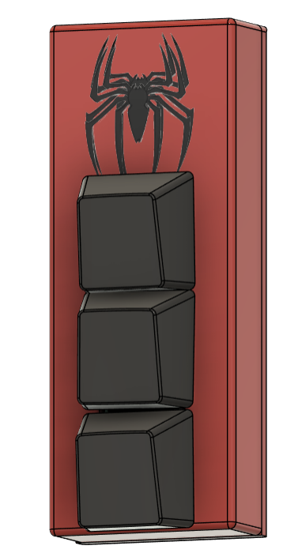
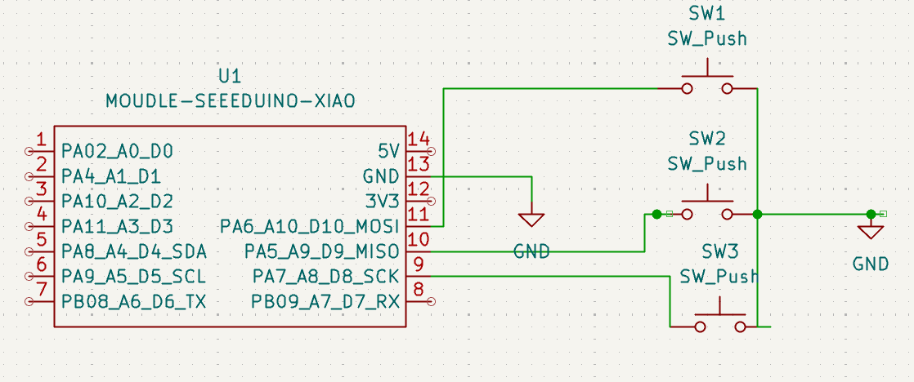
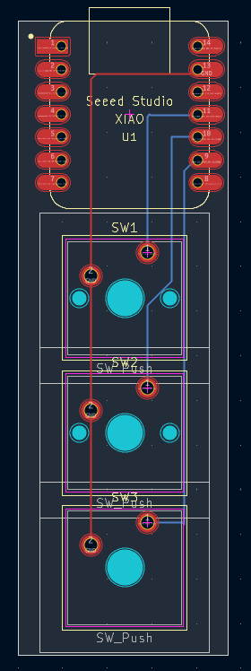

# HACKPAD

My unique spiderman themed macropad 

## FEATURES
  * Uses speed XIAO RP2040 to make the deign compact
  * two specially assigned keys for copy and paste functions
  * three keys 
  * SPIDERMAN themed.Looks awesome doesn't it??
## CAD Model
  * All parts are assembled using 4 M3 screws
  * It has 2 parts,the battom plate on which the pcb sits and the top cover which covers the pcb

  Made using fusion 360
## PCB
Here's my pcb.I made it in KiCad 

SCHEMATIC

          PCB
## FIRMWARE OVERVIEW
This HackPad uses KMK firmware for everything

  * The first key is programmed to perform the copy function (ctrl+c)
  * The second key is programmed to perform the paste function (ctrl+v)
  * The third key is programmed to perform the Print Screen function (Prt Sc)
I might add more in the future.
## BOM
  * 3x Cherry MX Switches
  * 3x DSA Keycaps
  * 1x XIAO RP2040
  * 1x Case(2 3d printed parts)
  * 4x M3x16mm SHCS Bolts
